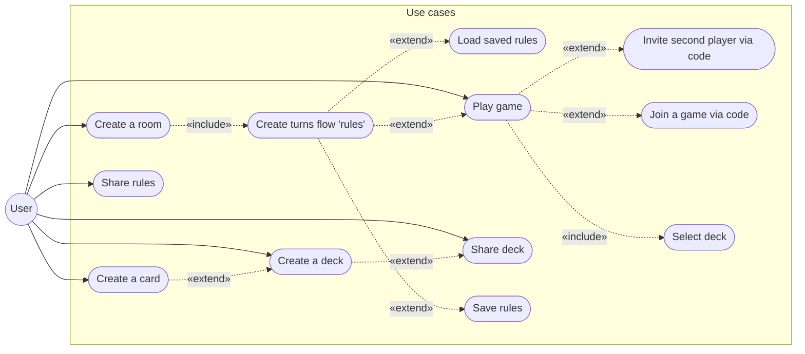

### General description
It is a web site, where you can create your own variation of game, using existing modulus for cards and rules. Then you can play it with second player.

### Game constraints:
1. Cards is the same as HeartStone cards. Base class "Cards" divides on "Creatures cards", that has HP, DMG, MP cost, origin and specific feature from existing (modulus), and on "Spell cards", that has DMG, MP cost, origin and specific effect from existing (modulus);
2. Field consist of three lines and six sections, three section for each of two players;
3. Two players only;
4. Game ends when one player conquer all field's sections or surrender;
5. Each player has mana, like in HeartStone.

### Use Case diagram

### Addition information:
1. Field has it's own's field type, that determined by deck origen;
2. Players have there own hand of active card and can use them according to created rules;
3. Players have there own stack of cards and can add cards to there hands according to created rules;
3. Examples of rules: firs player turn, active player moves cards, active player use cards, firs player turn ends, both players can move there cards and ect. 

### Backend idea
The modulus way of games may be implemented via "engine", that will go through JSON rules file and execute modulus parts of code that refer in it in loop.

### Frontend idea
All cards on board has to be movable if it is according to a rule and player owns them.
